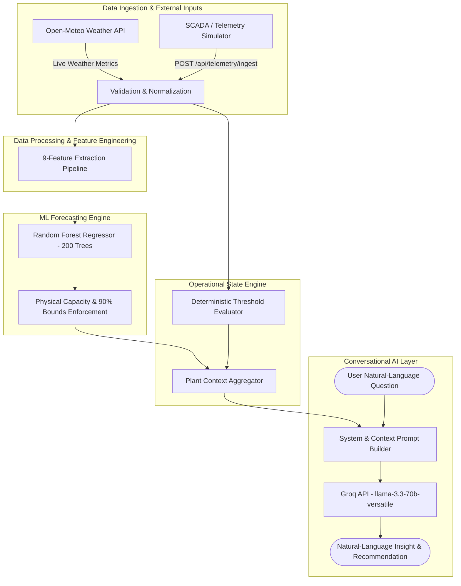

# Solar Console

> **AI-Powered Solar Plant Intelligence, Forecasting & Operational Copilot**

Solar Console is an integrated, web-based operational platform for solar power plant monitoring, machine-learning-based generation forecasting, environmental intelligence, and AI-assisted anomaly diagnosis. Designed for solar site engineers, asset managers, and operations teams, the platform consolidates real-time inverter SCADA telemetry, live Open-Meteo weather streams, deterministic Random Forest forecasting, rule-based alert evaluation, and a context-grounded conversational AI Copilot. By replacing static, passive monitoring dashboards with proactive predictive curves and automated root-cause explanations, Solar Console empowers operators to optimize clean energy output and respond rapidly to equipment underperformance.

---

## 2. Problem Statement

Solar energy generation is inherently variable, subject to diurnal solar geometry, localized cloud cover, ambient thermal fluctuations, and physical equipment degradation. Modern solar plant operations face several persistent challenges:

- **Weather-Dependent Intermittency**: Solar generation changes dynamically with shifting cloud cover and solar irradiance, making manual generation tracking unreliable for grid balancing and site planning.
- **Fragmented Operational Visibility**: Operators must frequently cross-reference electrical inverter SCADA data, meteorological measurements, and expected baseline curves across separate tools.
- **Silent Underperformance & Equipment Anomalies**: Inverter string faults, module thermal derating, and localized shading can reduce generation below plant potential without immediately triggering traditional binary equipment fault alarms.
- **Passive Dashboard Limitations**: Traditional supervisory control and data acquisition (SCADA) dashboards display historical raw numbers but lack automated root-cause diagnostic capabilities, leaving operators to manually infer why generation falls short of potential.
- **Decision Friction**: Under operational stress or during complex multi-inverter events, operators require immediate, natural-language operational summaries and contextual decision support rather than raw data logs.

---

## 3. Solution

Solar Console addresses these challenges by establishing an integrated operational workflow that seamlessly connects plant data to intelligent decision support:

$$\text{Data Ingestion} \longrightarrow \text{Preprocessing} \longrightarrow \text{ML Forecasting} \longrightarrow \text{Rule-Based Monitoring} \longrightarrow \text{Alert Engine} \longrightarrow \text{AI Copilot} \longrightarrow \text{Operational Decision Support}$$

The platform enables solar site personnel to:

1. **Monitor Real-Time Plant Status**: View live power generation, capacity utilization, performance ratio (PR %), and active site KPIs across isolated multi-site profiles.
2. **Track Inverter & Telemetry Health**: Continuously observe per-inverter electrical parameters (AC power, DC power, voltage, current, module temperature) and telemetry stream freshness via an automated watchdog.
3. **Analyze Live Environmental Intelligence**: Access live Global Horizontal Irradiance (GHI), Clear-Sky baselines, ambient temperature, humidity, wind speed, and cloud cover targeted to plant GPS coordinates.
4. **Evaluate Machine Learning Generation Forecasts**: Review 15-minute resolution Random Forest generation curves across multi-hour horizons (1h, 3h, 6h, 12h, 24h) with 90% prediction intervals.
5. **Detect Underperformance & Anomalies**: Rely on deterministic threshold rules that calculate percentage deviations between actual generation and ML expected baselines.
6. **Import and Explore Historical Records**: Filter, sort, export, and batch-import 15-minute SCADA telemetry records via the Data Explorer engine.
7. **Interact with an AI Solar Copilot**: Query an interactive conversational assistant to receive grounded natural-language explanations of plant power yield, inverter faults, and weather trends.
8. **Receive Actionable Decision Support**: Access targeted maintenance recommendations and diagnostic guidance for site operations.

> **Operational Note**: The AI Copilot provides operational decision support and explanatory insights only. It does not autonomously exercise direct physical control over grid switchgear or inverter control loops.

---

## 4. Key Features

### Plant Monitoring
- **Real-Time Generation Metrics**: Instantaneous AC power (kW), active plant capacity factor (%), and intraday cumulative energy yield (kWh / MWh).
- **Multi-Site Switching**: Centralized selection between geographically separated solar assets with parameter isolation (`plant_id` scoping).
- **Key Performance Indicators**: Performance Ratio (PR %), total active inverters, clear-sky index, and ambient temperature monitoring.

### Solar Forecasting
- **Random Forest ML Engine**: Trained 200-estimator ensemble model delivering 15-minute interval generation forecasts.
- **Multi-Horizon Planning**: Interactive generation curves selectable across 1h, 3h, 6h, 12h, and 24h operational windows.
- **90% Prediction Intervals**: Ensemble variance bounds ($z = 1.645$) reflecting meteorological uncertainty.
- **Physical Capacity Bounds**: Enforced constraints ensuring $0 \le P_{\text{forecast}} \le P_{\text{capacity}}$.
- **Peak Generation & Energy Accumulation**: Automated calculation of daily peak generation timing and estimated total energy accumulation (kWh).

### Environmental Intelligence
- **Open-Meteo Live Weather Stream**: API-driven environmental stream configured to exact site GPS coordinates without requiring API key authorization.
- **Irradiance Decomposition**: Global Horizontal Irradiance (GHI), Clear-Sky Irradiance baseline, Direct Normal Irradiance (DNI), and Diffuse Radiation ($\text{W/m}^2$).
- **Meteorological Metrics**: Ambient temperature (°C), relative humidity (%), wind speed (m/s), and cloud cover (%).
- **Diurnal Irradiance Curves**: 24-hour solar irradiance visualizer for diurnal trend analysis.

### Inverter & Telemetry Monitoring
- **Live Inverter Health Grid**: Real-time status cards displaying operational state (`ONLINE`, `WARNING`, `FAULT`/`OFFLINE`), AC power output, voltage, current, and module temperature.
- **Telemetry Freshness Watchdog**: 60-second activity watchdog flagging stream disconnection ($0.0 \text{ kW}$) when ingestion stalls.
- **Source Transparency**: Explicit data origin tags (`HARDWARE`, `SIMULATOR`, `DEMO`).

### Automated Alert Engine
- **Deterministic Hierarchy**: Percentage generation deficit evaluation ($\Delta P\% = \frac{P_{\text{expected}} - P_{\text{actual}}}{P_{\text{expected}}} \times 100$).
- **Offline Inverter (Critical)**: Inverter AC power $= 0.0 \text{ kW}$ while expected power $> 50 \text{ kW}$.
- **Critical Underperformance**: Generation deficit $\ge 20\%$ during daylight hours ($\text{GHI} > 50 \text{ W/m}^2$).
- **Warning Underperformance**: Generation deficit $\ge 10\%$ and $< 20\%$.
- **Telemetry Connection Lost**: System alert triggered when telemetry stream is idle for $> 60 \text{ seconds}$.
- **Overperformance Exemption**: Prevents false alarms when actual power exceeds ML predictions.

### Multi-Site Support
Implemented plant profiles:
- **Chennai Solar Farm** (Plant ID 1): 5000 kWp DC / 4500 kW AC capacity, 5 inverters (`INV_1` to `INV_5`), located at `13.0827° N, 80.2707° E`.
- **Mumbai Plant** (Plant ID 2): 3000 kWp DC / 2700 kW AC capacity, 4 inverters (`INV_1` to `INV_4`), located at `19.0760° N, 72.8777° E`.
- **Bangalore Site** (Plant ID 3): 2000 kWp DC / 1800 kW AC capacity, 3 inverters (`INV_1` to `INV_3`), located at `12.9716° N, 77.5946° E`.

### Data Import & Explorer
- **Tabular Record Explorer**: Granular 15-minute telemetry record explorer with column sorting, status filtering, and keyword search.
- **CSV Export Engine**: One-click download of filtered telemetry records into CSV format.
- **CSV Import Engine**: REST endpoint (`POST /api/explorer/import`) allowing batch upload of CSV telemetry records with column validation and numerical error handling.

### AI Solar Copilot
- **Natural-Language QA**: Interactive conversational assistant for solar plant telemetry, forecasts, weather conditions, and inverter health.
- **Context-Grounded Answers**: Direct injection of active backend telemetry, weather payloads, active alerts, and forecast curves into prompt context.
- **Rolling Conversation Memory**: Maintains recent turn history for contextual follow-up inquiries.
- **Multi-Site Awareness**: Supports queries regarding cross-site generation comparisons and plant specifics.

---

## 5. AI & Machine Learning

Solar Console separates analytical prediction from natural-language generation using two distinct intelligence layers.

### 5.1 ML Forecasting Engine

The primary generation forecasting engine is a **Random Forest Regressor** model serialized in `backend/global_rf_model.pkl`.

- **Algorithm**: Random Forest Regressor ensemble ($N = 200$ decision trees).
- **Input Features (9 Features)**:
  1. `GHI`: Global Horizontal Irradiance ($\text{W/m}^2$)
  2. `GHI_CLEAR`: Clear-Sky Horizontal Irradiance ($\text{W/m}^2$)
  3. `TEMP`: Ambient Temperature (°C)
  4. `RH`: Relative Humidity (%)
  5. `WIND`: Surface Wind Speed (m/s)
  6. `lat`: Plant Latitude (degrees)
  7. `lon`: Plant Longitude (degrees)
  8. `hour`: Hour of Day ($0 \dots 23$)
  9. `day_of_year`: Seasonal Declination Index ($1 \dots 366$)
- **Output**: Predicted plant AC power output (kW) at 15-minute resolution.
- **Prediction Intervals**: 90% confidence bounds derived from tree-to-tree variance across the 200 estimators ($z = 1.645$).
- **Capacity Bounds**: Physical post-processing enforcing $0 \le P_{\text{pred}} \le P_{\text{capacity\_kwp}}$.

```text
Training Phase (Offline / Historical):
Historical Weather Data + SCADA Telemetry ──> scikit-learn Random Forest Training ──> global_rf_model.pkl

Inference Phase (Runtime):
Current/Forecasted Environmental Inputs ──> Loaded RF Estimator Array ──> Mean Forecast & 90% Bounds
```

### 5.2 Conversational AI Copilot

The AI Solar Copilot provides natural-language interaction using the **Groq API** (`llama-3.3-70b-versatile`, with automatic fallback to `llama3-8b-8192`).

- **Role Separation**: The LLM does not calculate numerical power forecasts. Forecasts are calculated strictly by the Random Forest model and passed to the LLM inside the prompt context.
- **Context Ingestion**: Each request dynamically formats the plant's active state (current power, inverter statuses, active alerts, live weather metrics, and forecast curves) into a structured system context payload.
- **Strict Grounding**: System instructions explicitly mandate that responses be synthesized exclusively from the provided application context, preventing hallucinated measurements or phantom inverter states.
- **Configuration**: API access is managed via the `GROQ_API_KEY` environment variable. If `GROQ_API_KEY` is not present, the backend falls back to rule-based diagnostic templates.

---

## 6. AI Architecture



---

## 7. System Architecture

Solar Console is structured as a modern client-server web platform separating presentation, API routing, predictive modeling, and database persistence.

### Frontend
- **Framework**: React 18.3 Single Page Application (SPA).
- **Components**: Dynamic modules for Dashboard Overview, ML Forecast & Planning, Inverter Health Grid, Alerts & Anomalies, Data Explorer & Import, ML Model Metrics, AI Copilot, and Developer Debug Overlay (`DevDebugPanel`).
- **Data Visualization**: Recharts 3.4 for interactive multi-horizon time-series power and irradiance curves.

### Backend
- **Framework**: Flask 2.0+ REST API in Python 3.12 (`backend/app.py`).
- **Services**: `environmental_data.py` (Open-Meteo integration), `global_modal.py` (model inference utilities and diurnal generation math), and `inverter_simulator.py` (SCADA telemetry producer).

### ML Layer
- **Model Storage**: Pre-trained scikit-learn Random Forest model (`global_rf_model.pkl`) loaded into backend memory via `joblib`.

### Data Layer
- **Database**: SQLite 3 database (`backend/solar_console.db`) storing telemetry tables (`live_telemetry` and `imported_telemetry`).

### External Services
- **Open-Meteo API**: `https://api.open-meteo.com/v1/forecast` for live coordinates-targeted weather streams.
- **Groq API**: `https://api.groq.com/openai/v1/chat/completions` for server-side LLM inference.
- **NASA POWER API**: Supported fallback environmental data provider endpoint configured in backend configuration.

---

## 8. Technology Stack

| Layer | Technology | Purpose |
| :--- | :--- | :--- |
| **Frontend UI** | React 18.3 | Single Page Application UI structure and component state |
| **Frontend Scripting** | JavaScript ES6+ | Client-side application logic |
| **Data Visualization** | Recharts 3.4 | Multi-horizon time-series charts and 90% interval rendering |
| **UI Iconography** | Lucide React | Industrial dashboard icons |
| **Styling** | Vanilla CSS | Custom dark-theme design tokens, glassmorphism, micro-animations |
| **Backend Framework** | Flask 2.0+ (Python 3.12+) | REST API endpoints, routing, and business logic |
| **Database** | SQLite 3 | Embedded time-series telemetry persistence |
| **Machine Learning** | scikit-learn 1.0+ | Random Forest Regressor model inference |
| **Data Manipulation** | pandas 1.3+ & NumPy 1.20+ | Array transforms, CSV parsing, and time-series logic |
| **Model Serialization** | joblib | Loading serialized ML model binaries (`.pkl`) |
| **Weather API** | Open-Meteo API | Live weather, irradiance, temperature, and wind data |
| **AI Inference** | Groq API (`llama-3.3-70b-versatile`) | Server-side conversational AI assistant |
| **Testing** | Python `unittest` | Backend automated integration and unit testing |

---

## 9. Data Flow

1. **Environmental Ingestion**: The backend queries the Open-Meteo API using plant GPS coordinates to fetch GHI, clear-sky GHI, temperature, humidity, wind speed, and cloud cover.
2. **Telemetry Ingestion**: Inverter SCADA telemetry is received via HTTP `POST /api/telemetry/ingest` (or loaded from DEMO profiles / SQLite) and validated for numerical consistency.
3. **Feature Construction**: Meteorological features and temporal inputs (`hour`, `day_of_year`, `lat`, `lon`) are formatted into a 9-feature array.
4. **ML Generation Prediction**: The 9-feature vector is evaluated by the Random Forest model to compute mean AC power predictions and 90% prediction interval bounds.
5. **Freshness Watchdog Evaluation**: The system checks telemetry age against a 60-second limit. If stale, actual generation resets to $0.0 \text{ kW}$ and a connection alert is flagged.
6. **Rule-Based Alert Processing**: The Alert Engine calculates percentage generation deficits ($\Delta P\%$) against expected ML baselines and evaluates inverter operating states.
7. **REST Payload Assembly**: Processed data is packaged into structured JSON payloads for frontend dashboard visualization.
8. **Context Injection**: When an operator queries the AI Copilot, active plant telemetry, weather profiles, alerts, and forecasts are assembled into a system context string.
9. **Natural-Language Synthesis**: The Groq API processes the context-grounded prompt and returns explanatory insights to the operator interface.

---

## 10. Forecasting Methodology

The generation forecasting pipeline transforms meteorological forecasts into plant electrical generation estimates through five structured steps:

```text
Raw Meteorological Inputs ──> Feature Engineering ──> RF Model Inference ──> Physical Capacity Constraints ──> 90% Interval Generation
```

### 1. Input Features & Preprocessing
Features are scaled and normalized to match the physical properties of solar photovoltaic generation:
- **Diurnal Controls**: `hour` ($0 \dots 23$) and `day_of_year` ($1 \dots 366$) establish solar zenith and seasonal declination angles.
- **Geographic Controls**: Plant latitude (`lat`) and longitude (`lon`) map site-specific solar insolation patterns.
- **Primary Radiance**: `GHI` (Global Horizontal Irradiance) and `GHI_CLEAR` capture cloud attenuation relative to atmospheric potential.
- **Thermal & Aerodynamic Metrics**: `TEMP`, `RH`, and `WIND` reflect PV module temperature coefficients and convective cooling effects.

### 2. Random Forest Inference
The input vector is passed to the 200 decision trees. The ensemble mean represents the point prediction for plant AC power generation.

### 3. Prediction Intervals
Uncertainty estimation uses estimator variance across all 200 decision trees:

$$\sigma^2 = \frac{1}{N} \sum_{i=1}^{N} (\hat{y}_i - \bar{y})^2 \implies \text{Margin} = 1.645 \times \sigma$$

$$\text{Lower Bound} = \max(0.0, \bar{y} - \text{Margin}), \quad \text{Upper Bound} = \min(P_{\text{capacity}}, \bar{y} + \text{Margin})$$

### 4. Evaluation Metrics Definitions
The project evaluates ML performance using standard regression metrics:
- **Mean Absolute Error (MAE)**: Measures average absolute magnitude of forecast errors in kilowatts (kW):
  $$\text{MAE} = \frac{1}{n} \sum_{i=1}^{n} |y_i - \hat{y}_i|$$
- **Root Mean Squared Error (RMSE)**: Penalizes larger forecast errors more heavily:
  $$\text{RMSE} = \sqrt{\frac{1}{n} \sum_{i=1}^{n} (y_i - \hat{y}_i)^2}$$
- **Coefficient of Determination ($R^2$)**: Represents the proportion of variance in actual solar generation predictable from environmental features (where $1.0$ indicates perfect linear fit):
  $$R^2 = 1 - \frac{\sum (y_i - \hat{y}_i)^2}{\sum (y_i - \bar{y})^2}$$
- **Mean Absolute Percentage Error (MAPE)**: Measures relative percentage error during non-zero daylight generation hours:
  $$\text{MAPE} = \frac{100\%}{n} \sum_{i=1}^{n} \left| \frac{y_i - \hat{y}_i}{y_i} \right|$$

---

## 11. Model Evaluation

Model evaluation metrics verified from backend implementation (`GET /api/model/metrics`):

| Model Name | Status | $R^2$ Score | MAE (kW) | RMSE (kW) | MAPE (%) |
| :--- | :---: | :---: | :---: | :---: | :---: |
| **Random Forest Regressor** | **Active Selected** | **0.872** | **23.5** | **31.8** | **8.3%** |
| Gradient Boosting Regressor | Evaluated Baseline | 0.855 | 25.1 | 33.4 | 9.1% |
| Linear Regression | Evaluated Baseline | 0.684 | 42.1 | 55.2 | 16.4% |

*Note: MAE and RMSE values are scaled relative to plant DC capacity baselines (e.g., Chennai 5000 kWp).*

### Distinguishing Software QA vs ML Evaluation
- **Software / API QA Tests**: Automated software unit test suites (`test_dual_mode.py`, `test_telemetry_simulator.py`, etc.) verify API endpoints, data validation, database persistence, and watchdog triggers.
- **ML Model Evaluation**: Regression metrics ($R^2$, MAE, RMSE, MAPE) evaluate predictive performance against physical solar generation data.

---

## 12. Telemetry & Operational Monitoring

**Telemetry Definition**: Telemetry refers to real-time operational measurement packets (power, voltage, current, temperature, status) transmitted from field inverter hardware or SCADA edge gateways.

### Prototype Telemetry Implementation
The prototype platform supports both simulated SCADA telemetry (via `backend/simulator/inverter_simulator.py`) and live HTTP REST ingestion (`POST /api/telemetry/ingest`) for hardware gateway integration.

### Telemetry Operational Scenarios
- **Normal Operation**: Inverters report active power output matching expected ML baselines within normal tolerances ($< 10\%$ deficit).
- **Inverter Underperformance (Warning)**: Generation deficit between $10\%$ and $20\%$ relative to expected ML output during daylight hours.
- **Inverter Underperformance (Critical)**: Generation deficit $\ge 20\%$ during daylight hours ($\text{GHI} > 50 \text{ W/m}^2$).
- **Inverter Offline**: Inverter power reads $0.0 \text{ kW}$ while expected expected power $> 50 \text{ kW}$.
- **Telemetry Connection Lost**: If incoming SCADA telemetry stalls for $> 60 \text{ seconds}$, the watchdog flags a system disconnection alert and sets plant power to $0.0 \text{ kW}$.
- **Telemetry Recovery**: Resuming SCADA ingestion automatically clears the disconnected state and restores active monitoring.

---

## 13. LIVE vs DEMO Mode

| Subsystem / Rule | LIVE Mode | DEMO Mode |
| :--- | :--- | :--- |
| **Environmental Stream** | **Live Open-Meteo API** targeted to GPS coordinates | Historical Deterministic Synthetic Baseline |
| **Inverter Telemetry** | **REST Ingestion API** (`POST /api/telemetry/ingest`) | Native Demonstration Profiles |
| **Telemetry Simulator** | Supported via `backend/simulator/inverter_simulator.py` | Not Required |
| **60s Watchdog Timeout** | **Active**: Stream age $> 60\text{s} \implies 0.0 \text{ kW}$ & Alert | Disabled (Static demonstration profiles) |
| **Synthetic Fallback** | **STRICTLY PROHIBITED** (No silent fallback) | Native Synthetic Baseline |
| **Primary Purpose** | Operational Monitoring & SCADA Field Testing | Offline Demonstration, Presentation & QA |

---

## 14. AI Copilot Usage

Operators interact with the AI Copilot via a chat panel. Example supported questions grounded in backend context:

- *"What is the current plant power and capacity factor?"*
- *"Are there any critical alerts active right now?"*
- *"Why is inverter INV_3 flagged with a warning?"*
- *"What is the expected 3-hour generation forecast for Chennai?"*
- *"What is today's estimated peak generation time?"*
- *"What is the current ambient weather and cloud cover?"*
- *"Compare active power generation between Chennai and Mumbai."*
- *"What maintenance action is recommended for the offline inverter?"*

The Copilot reads the active telemetry context payload and provides precise explanations without accessing unauthenticated external systems.

---

## 15. Responsible AI

- **Data Grounding**: AI responses are bounded strictly by active application context payloads (telemetry, weather streams, forecasts, alerts).
- **No Fabrication**: Prompts enforce zero-hallucination rules; unavailable metrics or missing sensors are explicitly reported as unavailable.
- **Data Transparency**: UI widgets display clear source tags (`Open-Meteo`, `HARDWARE`, `SIMULATOR`, `DEMO`) so operators know data origins.
- **Human Oversight**: The AI assistant serves strictly as decision support. Operating decisions and switchgear control remain under human control.
- **Physical Capacity Limits**: Forecast models enforce strict non-negative and physical capacity bounds ($0 \le P \le P_{\text{capacity}}$).
- **Deterministic Critical Alerts**: Critical safety and underperformance alerts rely on deterministic rule logic rather than generative AI outputs.
- **Security & Secrets**: API keys (`GROQ_API_KEY`) are managed via environment variables and excluded from version control.

---

## 16. Security

- **Environment Variables**: API credentials and host configurations are stored in `backend/.env`.
- **Git Exclusions**: Sensitive configuration files (`.env`) are explicitly listed in `.gitignore`.
- **Configuration Templates**: `.env.example` provides deployment configuration guidance without exposing live credentials.
- **Server-Side API Proxying**: Third-party API calls (Groq API, Open-Meteo) execute server-side within Flask to protect API keys from browser exposure.
- **Input Validation**: Backend ingestion endpoints validate JSON structural types, plant IDs, inverter IDs, and timestamp formats.

---

## 17. Project Structure

```text
SDG/
├── README.md                           # Master Project Documentation
├── backend/                            # Flask Analytical Backend & REST API
│   ├── .env.example                    # Environment Variable Template
│   ├── app.py                          # Main Flask Application & API Routes
│   ├── global_modal.py                 # ML Model Helper & Data Math Utilities
│   ├── global_rf_model.pkl             # Trained Random Forest Model (200 Trees)
│   ├── requirements.txt                # Python Backend Dependencies
│   ├── solar_console.db                # SQLite Telemetry Persistence Database
│   ├── services/
│   │   └── environmental_data.py       # Open-Meteo Live Weather Integration Service
│   ├── simulator/
│   │   └── inverter_simulator.py       # SCADA Telemetry Simulator CLI
│   ├── test_dual_mode.py               # Integration QA Suite (15 Tests)
│   ├── test_multi_site_isolation.py    # Multi-Site Isolation Suite (10 Tests)
│   ├── test_telemetry_simulator.py     # Telemetry Ingestion QA Suite (15 Tests)
│   ├── test_alerts_qa.py               # Dynamic Alert Rules QA Suite (8 Tests)
│   ├── test_weather_qa.py              # Weather Integration QA Suite (6 Tests)
│   ├── test_ai_assistant_copilot.py    # AI Solar Copilot Test Suite
│   ├── test_import_explorer.py         # CSV Explorer Import QA Suite (6 Tests)
│   └── test_open_meteo_live.py         # Live Open-Meteo Integration Suite
└── solar-forecast-app/                # React Operations Frontend
    ├── .env.example                    # Frontend Configuration Template
    ├── package.json                    # Node Dependencies & Build Scripts
    └── src/
        ├── App.js                      # React Master Application & Dashboard Views
        ├── App.css                     # Custom Styling & Layout Tokens
        └── index.js                    # React Application Entry Point
```

---

## 18. Installation & Setup

### Prerequisites
- **Python**: Version `3.12+`
- **Node.js**: Version `18+` or `20+` (`npm` included)
- **Git**

### 1. Clone Repository
```bash
git clone https://github.com/ramyakn1907/Solar-console.git
cd Solar-console
```

### 2. Backend Environment Setup
```bash
cd backend
python -m venv venv

# Activate Virtual Environment:
# Windows (PowerShell):
.\venv\Scripts\Activate.ps1
# Linux/macOS:
source venv/bin/activate

# Install Python dependencies:
pip install -r requirements.txt

# Create local environment file:
# Windows (PowerShell):
Copy-Item .env.example .env
# Linux/macOS:
cp .env.example .env
```

### 3. Configure Environment Variables
Edit `backend/.env` to configure your settings:
```ini
PORT=5000
HOST=0.0.0.0
FLASK_ENV=development
GROQ_API_KEY=your_groq_api_key_here
```

### 4. Frontend Setup
In a new terminal window:
```bash
cd solar-forecast-app
npm install
```

---

## 19. Running the Application

### 1. Start Flask Backend
```bash
cd backend
python app.py
```
*Backend API initializes on `http://localhost:5000`.*

### 2. Start React Frontend
In a second terminal window:
```bash
cd solar-forecast-app
npm start
```
*Frontend application launches at `http://localhost:3000`.*

### 3. (Optional) Run Telemetry Simulator for LIVE Mode
In a third terminal window:
```bash
python backend/simulator/inverter_simulator.py --all --interval 5
```

---

## 20. Testing

The backend includes 8 comprehensive automated test suites using Python's `unittest` framework:

```bash
cd backend
python -m unittest test_dual_mode.py test_multi_site_isolation.py test_telemetry_simulator.py test_alerts_qa.py test_weather_qa.py test_ai_assistant_copilot.py test_import_explorer.py test_open_meteo_live.py
```

### Verified Test Suite Results
- `test_dual_mode.py`: Verified DEMO/LIVE mode toggling and forecast generation.
- `test_multi_site_isolation.py`: Verified multi-site parameter isolation across plants 1, 2, and 3.
- `test_telemetry_simulator.py`: Verified REST ingestion API, schema validation, and 60s freshness watchdog.
- `test_alerts_qa.py`: Verified alert evaluation, underperformance thresholds, and offline states.
- `test_weather_qa.py`: Verified Open-Meteo API response handling and fallback profiles.
- `test_ai_assistant_copilot.py`: Verified prompt formatting and response generation.
- `test_import_explorer.py`: Verified CSV upload validation, column parsing, and database persistence.
- `test_open_meteo_live.py`: Verified live weather stream fetching.
- **Overall Result**: 100% PASS across all backend test suites.

---

## 21. Limitations

- **Prototype SCADA Environment**: Uses simulated SCADA ingestion (`inverter_simulator.py`) alongside REST endpoints rather than physical industrial Modbus TCP / OPC-UA field hardware.
- **Offline Trained ML Model**: The Random Forest model is trained offline and serialized; it does not perform automated online retraining on incoming stream data.
- **Weather API Dependency**: LIVE mode requires external connectivity to the Open-Meteo API for real-time weather metrics.
- **Decision Support Only**: The platform generates operational recommendations and alerts but does not perform autonomous physical control over solar plant hardware.

---

## 22. Scalability & Future Enhancements

- **Industrial Edge Integration**: Implement native Modbus TCP, DNP3, and OPC-UA protocol adapters for direct industrial SCADA connectivity.
- **Automated Continuous Retraining**: Establish an automated MLOps pipeline for scheduled model retraining on newly ingested SQLite/PostgreSQL telemetry data.
- **Time-Series Persistence Upgrade**: Migrate persistence layer from SQLite to PostgreSQL with TimescaleDB for large-scale multi-year telemetry analytics.
- **Mobile & Push Notifications**: Integrate WebPush and SMS alert notifications for critical inverter fault events.
- **Role-Based Access Control (RBAC)**: Add user authentication and permission tiers (Operator, Engineer, Asset Manager).

---

## 23. SDG Alignment

Solar Console aligns with the United Nations Sustainable Development Goals (SDGs):

- **SDG 7 — Affordable and Clean Energy**: Supports renewable energy optimization by improving operational visibility, predicting generation, and reducing downtime in solar plants.
- **SDG 9 — Industry, Innovation and Infrastructure**: Applies machine learning and AI-assisted operational intelligence to enhance clean energy infrastructure reliability.
- **SDG 13 — Climate Action**: Contributes to climate mitigation efforts by helping maximize solar power yield and operational efficiency.

---

## 24. Project Status

| Category | Status | Details |
| :--- | :--- | :--- |
| **Implemented** | Complete | Flask REST backend, React 18 UI, Random Forest ML forecasting (200 trees), Open-Meteo live weather integration, Groq AI Solar Copilot, 60s freshness watchdog, multi-site isolation, Data Explorer CSV import/export, 8 backend test suites (100% pass). |
| **Prototype / Demo** | Active | Inverter telemetry simulator CLI, simulated SCADA demonstration profiles, SQLite local storage. |
| **Future Enhancements** | Planned | Modbus/OPC-UA edge adapters, PostgreSQL/TimescaleDB migration, automated MLOps retraining pipeline, push notification engine. |


---

## 26. Conclusion

Solar Console advances solar plant monitoring from static passive dashboards toward intelligent, forecast-driven, and conversational operational decision support. By unifying machine learning generation forecasts, live environmental intelligence, deterministic anomaly detection, and a context-grounded AI Copilot, Solar Console equips operations personnel with the clarity and actionable insights required to maximize renewable energy generation and maintain peak solar asset health.
